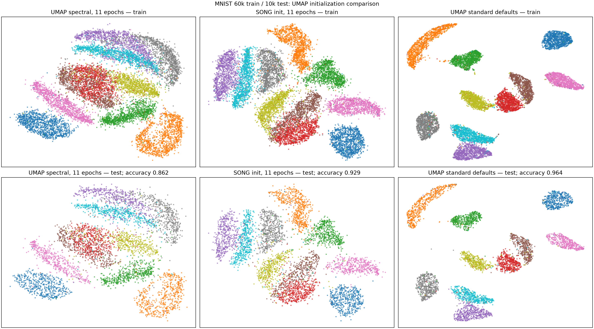
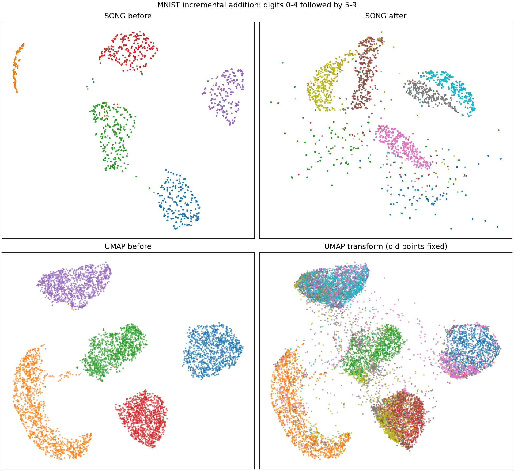
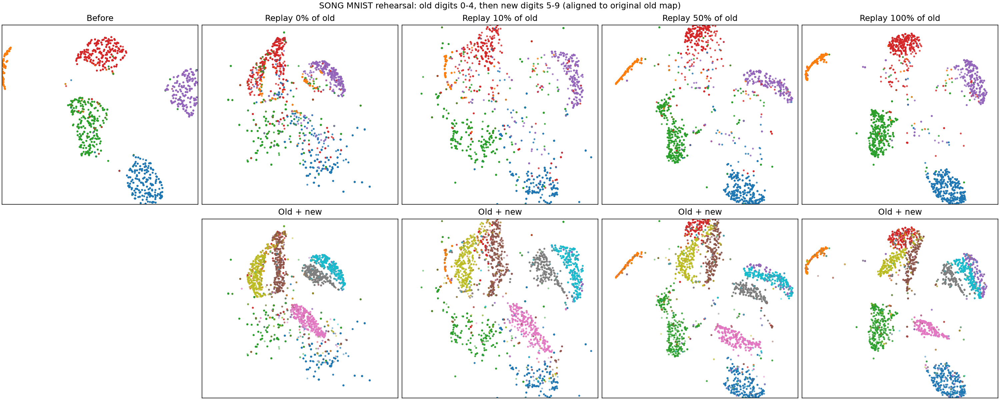
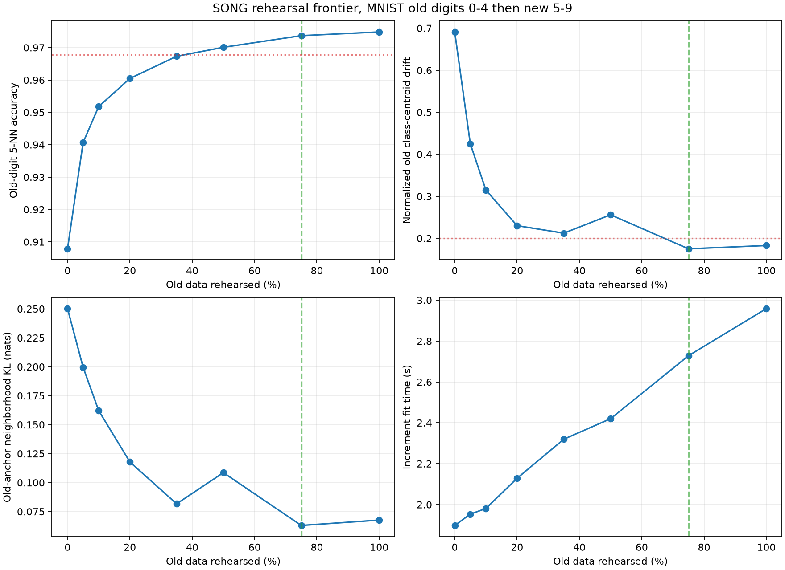
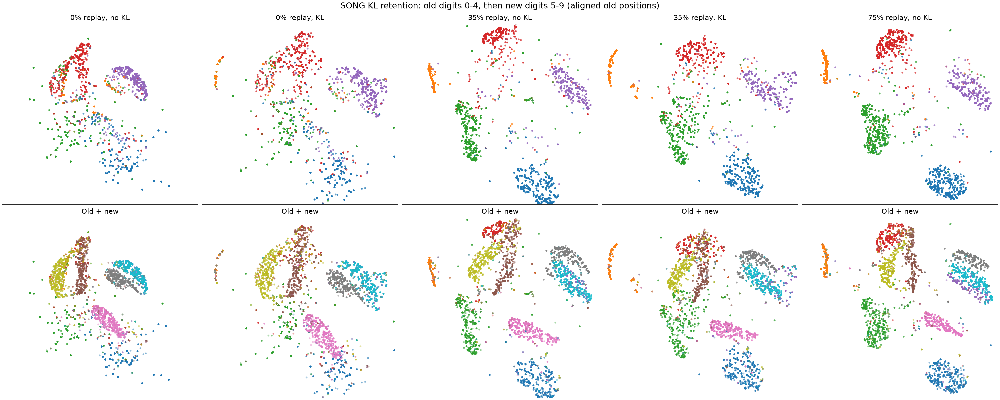
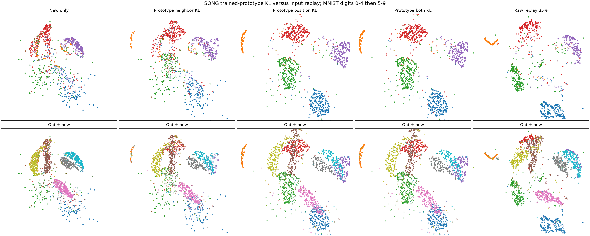

# SONG as an initialization for UMAP: a preliminary MNIST study

**Draft preprint — revised 24 October 2026**

Damith Senanayake *(draft attribution; final author list and affiliations to confirm)*

## Abstract

We evaluate Self-Organizing Nebulous Growths (SONG) as a data-driven initial layout for Uniform Manifold Approximation and Projection (UMAP). SONG creates a prototype graph and a two-dimensional map; assigning each observation to its nearest prototype supplies a coordinate for UMAP's `init` parameter. This combination is motivated by three goals: faster useful layouts, incremental addition of heterogeneous data while retaining prior structure, and placement of unseen observations. On the canonical MNIST 60,000/10,000 train/test split, a SONG-initialized 11-epoch UMAP achieves 92.87% held-out five-nearest-neighbor digit accuracy versus 86.19% for spectral initialization at the same epoch count. The SONG stage makes total fitting slower, however: 7.68 s versus 3.06 s. At 50 epochs the methods have essentially equal accuracy (96.04% versus 96.09%), with SONG initialization again slower end to end (10.65 s versus 5.55 s). A retained hybrid UMAP reducer transforms held-out images in 0.80 s. UMAP already supports transformation and incremental update, so the contribution tested here is initialization quality and the potential to align incremental layouts, rather than introducing those operations. In an ordered MNIST addition without old-data rehearsal, old-digit probe accuracy falls from 97.78% to 90.78% and the original class positions change substantially. Rehearsal recovers much of that structure: the smallest tested fraction meeting an illustrative accuracy-and-position target is 75% of old images. A measured old-anchor neighborhood KL decreases from 0.250 to 0.063 nats at that fraction. We additionally implement an opt-in KL coordinate refinement. Across three incremental-run seeds at 35% rehearsal, it reduces mean normalized old-class centroid drift from 0.224 to 0.112, but does not improve the mean old-digit accuracy loss. Thus KL helps retain positions while rehearsal is still needed for class separation. A separate prototype-only experiment, using no old images during the update, keeps old-digit accuracy loss near 0.5 percentage points and centroid drift near 0.03 across three seeds when trained prototype positions are preserved. Exact prototype restoration matches Gaussian-position KL and is faster. The evidence does not yet support an end-to-end SONG-initialized UMAP speedup or proven incremental retention for the combined model.

## 1. Introduction

UMAP constructs a neighborhood graph and optimizes a low-dimensional embedding. Its default spectral initialization is an effective general choice, but a learned prototype map may start optimization closer to a useful arrangement. SONG learns prototypes, their graph, and low-dimensional prototype locations, and was designed for incremental visualization, including heterogeneous additions [1]. We ask whether SONG coordinates can initialize UMAP to improve the quality obtained under a short optimization budget.

The distinction between the components matters. The current experiment uses SONG to initialize one UMAP fit. It does **not** incrementally update the resulting hybrid embedding. UMAP itself already provides `transform` for unseen points and `update` for adding data [3]. Therefore, preserving an existing structure during heterogeneous addition is a separate hypothesis, requiring a combined-model experiment rather than inference from SONG alone.

## 2. Method

Given training observations $X=\{x_i\}_{i=1}^n$, SONG learns input-space coding vectors $w_j$ and output-space prototype locations $z_j$. Each observation receives the two-dimensional coordinate of its nearest coding vector,

$$
j^*(i)=\operatorname*{argmin}_j \|P(x_i)-P(w_j)\|_2^2, \qquad y_i^{(0)}=z_{j^*(i)}.
$$

where $P$ is the fitted 50-component PCA transform. The array $Y^{(0)}$ is passed as UMAP's explicit `init` argument. UMAP then performs its usual neighborhood-graph construction and low-dimensional optimization. A fitted UMAP reducer is retained to place test observations using `transform`; no separate UMAP fit is made on test data.

The current SONG implementation selects the closest prototype by exact brute-force distance. On 10,000 queries against 1,557 prototypes in 50 dimensions, scikit-learn's `ArgKmin` returned identical indices in 7.38 ms versus 40.27 ms for the current Numba kernel (median of three warm runs). This accelerates that query stage, but the stage is a small fraction of the complete fit. The SONG training profile attributes 4.20 s to sequential prototype/map updates and 0.51 s to pairwise distances during a 5.04 s, 100-step fit. We therefore make no whole-pipeline speed claim from the query benchmark.

## 3. Experimental setup

We use the canonical Keras MNIST split: 60,000 training and 10,000 test 28×28 grayscale images [4]. Pixels are scaled to [0, 1]. SONG is fitted on training images only, with 100 self-organizing steps and seed 42. The same SONG-fitted 50-component PCA coordinates are supplied to **both** UMAP initialization arms, making UMAP input preprocessing identical. Both use 15 neighbors, `min_dist=0.1`, `spread=1`, learning rate 1, and seed 42. The 11- and 50-epoch arms differ only in initialization. We also show UMAP's automatic epoch budget as context, not a matched-budget comparator. UMAP's full-size graph and out-of-sample JIT kernels were warmed before timing. Timings are wall clock on one Apple Silicon Mac with four Numba and BLAS threads; each configuration has one measured seed. Labels are excluded from fitting and used only for evaluation: a five-nearest-neighbor classifier is trained on the 2D training coordinates and evaluated on transformed test coordinates.

## 4. Results

| Initialization | UMAP epochs | UMAP fit (s) | SONG preparation (s) | Total fit (s) | Test transform (s) | Held-out 5-NN accuracy |
| --- | ---: | ---: | ---: | ---: | ---: | ---: |
| Spectral | 11 | 3.06 | 0 | 3.06 | 0.79 | 86.19% |
| SONG | 11 | 2.09 | 5.59 | 7.68 | 0.80 | 92.87% |
| Spectral | 50 | 5.55 | 0 | 5.55 | 1.10 | 96.09% |
| SONG | 50 | 5.06 | 5.59 | 10.65 | 0.98 | 96.04% |
| Spectral, UMAP default epoch budget | automatic | 17.04 | 0 | 17.04 | 2.18 | 96.35% |

The short SONG-initialized optimization improves held-out accuracy by 6.68 percentage points over spectral initialization at 11 epochs. Its UMAP-only fit is 0.96 s shorter, but SONG preparation adds 5.59 s. At 50 epochs, the accuracy difference is −0.05 percentage points and the combined fit is 5.10 s longer. The spectral 50-epoch run also exceeds the SONG 11-epoch accuracy. Thus the observed benefit is **quality under a fixed UMAP epoch count**, not end-to-end speed at matched quality.

*Figure 1. A fixed random subsample of 12,000 training and 5,000 test images per panel. Colors denote digit labels used for evaluation only. Test coordinates come from the retained fitted reducer.*

### 4.1 Heterogeneous addition

We fit SONG on the 30,596 training images labeled 0–4 for 30 steps, then call `fit` again on the 29,404 images labeled 5–9 for another 30 steps. The second fit takes 1.96 s after a 1.08 s initial fit; the map has 1,783 prototypes afterward. On a fixed random sample of 1,000 old images, only **8.17%** of their 15 nearest old embedding neighbors remain after the update. Procrustes disparity is 0.658 after centering, scaling, and optimal rotation. The observed change combines movement of prototype coordinates and reassignment of images to prototypes. This run therefore **does not support** a claim that the current SONG implementation retains old structure for this heterogeneous increment.

For comparison, 50-epoch UMAP fits the initial digits in 7.60 s and `transform` places all new digits in 6.13 s without modifying old coordinates. Old-neighbor overlap is consequently 100% by construction; this baseline does not adapt the old embedding to new data. Calling the installed UMAP `update` on this particular 5–9-only increment raised `ZeroDivisionError` in `init_update`, so no UMAP-update retention value is available. This is one failure case, not evidence that UMAP lacks an update operation [3].

*Figure 2. SONG prototype assignments before and after incremental fitting, and UMAP before and after `transform`. Colors indicate digit labels. The figure displays a fixed random subsample of each group.*

This experiment tests the separate SONG component; a hybrid anchor-and-refine method remains future work. Raw values are in [`reports/song_increment_mnist.json`](../reports/song_increment_mnist.json), and the [script](../reports/song_increment_mnist.py) reproduces the experiment.

### 4.2 Rehearsal budget and a distributional retention objective

The previous update presents only new digits, so old classes are absent from the training objective. To test whether rehearsal addresses this, we copy the same fitted old SONG state and fit on all new images plus a nested random sample of old images at 0, 5, 10, 20, 35, 50, 75, or 100% of the old set. The old-digit 5-NN probe uses a fixed stratified 80/20 split of old image labels for evaluation only; initial accuracy is 97.78%. Class-centroid drift is RMS movement after Procrustes alignment, normalized by the initial embedding's RMS spread. The KL measure below uses 512 fixed old anchors.

| Old set rehearsed | Update time (s) | Old-digit 5-NN accuracy | Normalized class-centroid drift | Old-anchor KL (nats) |
| ---: | ---: | ---: | ---: | ---: |
| 0% | 1.90 | 90.78% | 0.691 | 0.250 |
| 10% | 1.98 | 95.18% | 0.315 | 0.162 |
| 35% | 2.32 | 96.73% | 0.212 | 0.082 |
| 50% | 2.42 | 97.01% | 0.256 | 0.109 |
| 75% | 2.73 | 97.37% | 0.175 | 0.063 |
| 100% | 2.96 | 97.48% | 0.183 | 0.068 |

As one **illustrative optimization rule**, choose the smallest measured rehearsal fraction with old-digit accuracy no more than one percentage point below the initial 97.78% and centroid drift at most 0.20. Among these tested fractions, 75% satisfies both. The 50% run shows that drift can worsen even as rehearsal increases, so a binary search assuming monotonic retention would be unsafe. A production, label-free rule should use held-out old anchors and a calibrated neighborhood-KL or positional-drift budget, with repeated seeds and confidence bounds. Prototype-balanced replay and selecting samples that cover old regions are plausible ways to reach the same retention with fewer stored images; they have not been tested here. More generally, the research optimization is to minimize update time plus a storage cost over replay fraction $r$ and retention weight $\lambda$, subject to a held-out old-anchor KL budget, a frame-drift budget, and a minimum quality score for new data. Evaluate a coarse set of $r$ values, refine near feasible candidates, and confirm the chosen point across seeds; the measured nonmonotonicity makes a single binary-search pass unreliable.

For fixed old anchors $A$, define a distribution over each anchor's other old neighbors in the **old** and **updated** embeddings:

$$
p_{ij}^{(t)} = \frac{\exp(-\|y_i^{(t)}-y_j^{(t)}\|_2^2/\tau)}{\sum_{k\in A,\;k\ne i}\exp(-\|y_i^{(t)}-y_k^{(t)}\|_2^2/\tau)},\quad j\ne i,\quad t\in\{0,1\}.
$$

The diagnostic retention loss is $L_{\mathrm{KL}}=|A|^{-1}\sum_{i\in A}D_{\mathrm{KL}}(p_i^{(0)}\|p_i^{(1)})$, using a fixed bandwidth $\tau$ equal to the median positive squared distance among initial anchor pairs. The opt-in implementation minimizes $\lambda L_{\mathrm{KL}}+\mu L_{\mathrm{position}}$ **after** each incremental SONG fit. The neighborhood KL measures changes in relative layout; the Gaussian-position KL keeps old anchors in their original coordinate frame. L-BFGS adjusts only the coordinates of prototypes selected by stored anchors. This is a post-update coordinate refinement: it does not alter SONG coding vectors, adjacency, or the sequential update loss. A fully joint $L_{\mathrm{SONG}}+\lambda L_{\mathrm{KL}}+\mu L_{\mathrm{position}}$ objective remains future work. A KL directly between two raw coordinate vectors would be undefined without specifying position distributions; with equal isotropic Gaussian variance, the position KL reduces to a scaled squared displacement.

*Figure 3. Old positions aligned to the initial map. The qualitative panels use independent random replay draws; the quantitative sweep above uses nested replay sets.*

*Figure 4. The dashed vertical line marks the smallest tested fraction meeting the example accuracy and drift targets. The dotted horizontal lines show those targets.*

The [rehearsal script](../reports/song_rehearsal_mnist.py), [frontier and novelty script](../reports/song_rehearsal_optimization.py), and [raw optimization results](../reports/song_rehearsal_optimization.json) reproduce these observations.

### 4.3 Implemented KL coordinate refinement

The implementation stores 512 old input anchors when the first SONG model is fitted; these fixed anchors are not expanded to cover later increments. After each later fit, it maps those anchors to their current nearest prototypes and uses L-BFGS to minimize the old-neighborhood KL above plus equal-variance Gaussian KL between each old and new anchor position. Anchors are **not** replayed through SONG's input-prototype update. The options are `retention_kl_weight`, `retention_position_weight`, `retention_anchor_count`, and `retention_maxiter`; both weights default to zero. The [source module](../song/retention.py) contains the analytic gradient and [tests](../tests/test_retention.py) check it against finite differences.

A matched MNIST ablation copies one model fitted on digits 0–4, presents digits 5–9 plus a nested old-data replay sample, then measures old and new class separation on fixed stratified label probes. Initial old-digit accuracy is 97.78%. The example target remains at most a one-percentage-point old-accuracy loss and normalized old-centroid drift at most 0.20.

| Update condition | Fit time (s) | Old 5-NN accuracy | New 5-NN accuracy | Old centroid drift | Anchor KL (nats) |
| --- | ---: | ---: | ---: | ---: | ---: |
| 0% replay, no KL | 2.06 | 90.78% | 95.63% | 0.681 | 0.296 |
| 0% replay, both KL terms | 2.35 | 90.26% | 95.54% | 0.208 | 0.025 |
| 35% replay, no KL | 2.33 | 96.90% | 95.26% | 0.226 | 0.089 |
| 35% replay, both KL terms | 2.45 | 96.90% | 95.07% | 0.092 | 0.002 |
| 50% replay, no KL | 2.55 | 96.88% | 94.85% | 0.191 | 0.071 |
| 75% replay, no KL | 2.67 | 97.70% | 94.73% | 0.185 | 0.076 |

At 35% replay in seed 42, the KL refinement reduces centroid drift by about 59% without improving old-digit accuracy. Under this example target, 35% replay plus KL passes while 35% without KL fails. The first passing no-KL fraction tested in this seed is 50%, a possible 30% replay-memory reduction **for this run only**. At zero replay, KL improves position retention but does **not** restore old class separation: the coding vectors have already adapted to the new classes. Old input-prototype retention still needs rehearsal or a separate prototype regularizer. New-digit accuracy at 35% decreases by 0.19 percentage points with KL in seed 42.

A follow-up with three SONG seeds (42, 43, 44) checks that single-seed selection. Values below are means ± sample standard deviations; each run uses the same initial state for its KL and no-KL arms. The pass count applies the example one-percentage-point old-accuracy-loss and 0.20 centroid-drift thresholds.

| Replay | KL refinement | Old accuracy drop (pp) | Old centroid drift | Mean fit time (s) | Target passed |
| ---: | :---: | ---: | ---: | ---: | ---: |
| 35% | no | 1.18 ± 0.27 | 0.224 ± 0.040 | 2.26 | 0/3 |
| 35% | yes | 1.24 ± 0.35 | 0.112 ± 0.021 | 2.44 | 1/3 |
| 50% | no | 1.00 ± 0.21 | 0.180 ± 0.028 | 2.41 | 2/3 |
| 50% | yes | 0.92 ± 0.13 | 0.098 ± 0.008 | 2.60 | 2/3 |

KL consistently reduces positional drift at both replay fractions, but the 35% memory-budget claim does **not** replicate across seeds. No condition meets the illustrative target in every seed. The added coordinate refinement costs about 0.18–0.19 s per update in this setup. The [three-seed CSV](../reports/song_retention_kl_seeds.csv) and [script](../reports/song_retention_kl_seeds.py) contain individual runs.

*Figure 5. Old positions are aligned to the original map. All panels use common axis limits based on the 0.5th and 99.5th percentiles; extreme outliers are clipped for display. The matched 35% panels show the effect of KL refinement.*

The [ablation script](../reports/song_retention_kl_mnist.py) and [raw JSON](../reports/song_retention_kl_mnist.json) include all tested conditions and optimizer diagnostics.

### 4.4 Trained-prototype KL without old-image replay

This is a **separate experiment** from the old-input-anchor and rehearsal studies. Immediately before an increment, the new mode snapshots SONG's trained input coding vectors $W^{(0)}$ and output positions $Y^{(0)}$. It prevents their indices from being recycled while new prototypes grow. After fitting on **only** the 29,404 images labeled 5–9, it applies the same distributional neighborhood KL and Gaussian-position KL to corresponding old input and output prototypes. Input prototype KL is calculated in the fitted 50-component PCA space; its optimized displacement is mapped back to raw coding vectors. No old image rows or old-input anchor sample enter the update. Seed 42 starts with 909 old prototypes, about 2.85 MB of float32 input snapshots, versus about 33.6 MB for a 35% sample of old raw images.

Ablations distinguish the two KL terms, a no-regularizer control, exact restoration of $W^{(0)}$ and $Y^{(0)}$, and 35% raw-image rehearsal. The table summarizes three seeds (42–44); values are means ± sample standard deviations where shown. The old-accuracy drop is relative to each seed's initial old-digit probe. New-class accuracy is a separate 5-NN probe on digits 5–9. The pass count uses the same illustrative ≤1 percentage-point old-accuracy loss and ≤0.20 normalized centroid-drift target.

| Update method | Old image replay | Old accuracy drop (pp) | New accuracy | Old centroid drift | Fit time (s) | Target passed |
| --- | ---: | ---: | ---: | ---: | ---: | ---: |
| New images only | 0 | 6.82 ± 0.37 | 95.88% | 0.597 ± 0.104 | 1.92 | 0/3 |
| Prototype neighborhood KL | 0 | 5.64 ± 0.48 | 94.80% | 0.373 ± 0.026 | 2.34 | 0/3 |
| Prototype Gaussian-position KL | 0 | 0.50 ± 0.29 | 94.93% | 0.030 ± 0.006 | 2.15 | 3/3 |
| Both prototype KL terms | 0 | 0.46 ± 0.33 | 95.07% | 0.030 ± 0.005 | 2.32 | 3/3 |
| Restore trained prototypes exactly | 0 | 0.50 ± 0.29 | 94.93% | 0.030 ± 0.006 | 1.91 | 3/3 |
| Rehearse 35% of old images | 10,709 | 1.15 ± 0.25 | 94.93% | 0.202 ± 0.011 | 2.29 | 0/3 |

Neighborhood KL alone preserves some relative geometry but does not adequately retain old class identity. Gaussian-position KL nearly restores the old prototypes exactly because, with fixed equal covariance, it is a scaled squared-distance penalty. The explicit snapshot-restore control yields the same probe and drift results as position-only KL at lower cost. Adding neighborhood KL to position KL provides a small mean old-accuracy and new-accuracy gain in these three runs, but it has not established a meaningful advantage over hard restoration. All methods trade some new-class quality against the no-retention control. The graph $G$ is updated on new images before prototype restoration; whether its edges remain suitable for later increments or a hybrid UMAP refinement has not been tested. The dense prototype KL is quadratic in the number of retained prototypes, so larger maps will need sparse or sampled prototype neighborhoods. No multi-increment or cross-dataset result follows from this table.

*Figure 6. Seed-42 embeddings aligned on old images, with common axis limits. The upper row shows old digits; the lower row adds the new digits.*

The [prototype-mode implementation](../song/song.py), [seed-42 ablation](../reports/song_prototype_kl_mnist.py), [three-seed script](../reports/song_prototype_kl_seeds.py), [raw seed results](../reports/song_prototype_kl_seeds.csv), and [full seed-42 metrics](../reports/song_prototype_kl_mnist.json) reproduce the comparison.

### 4.5 Novelty from old-map distance and position KL

For a vector arriving **before** an update, there is no updated position to compare against. We therefore tested the frozen old map's exact nearest-prototype squared distance as a pre-update novelty score. On the canonical 10,000-image test set, with digits 0–4 treated as known and 5–9 as heterogeneous new classes, it gives AUROC **0.881**. The median squared distances are 13.71 for known and 27.32 for new digits. A KL from each input's soft assignment over old prototypes to the old prototype-occupancy distribution gives AUROC **0.464** in this setting; that particular KL is not a useful detector here.

After fitting a full-rehearsal updated SONG map, we also align the new map on old anchors and compare each test image's old and updated 2D positions. If each position is modeled as an isotropic Gaussian with common variance $\sigma^2$, then $D_{\mathrm{KL}}(\mathcal N(y^{(0)},\sigma^2I)\|\mathcal N(y^{(1)},\sigma^2I))=\|y^{(0)}-y^{(1)}\|_2^2/(2\sigma^2)$. With $\sigma^2=\tau$ from the anchor scale above, this **post-update** score gives AUROC **0.758**; median scores are 0.012 for old and 0.056 for new test digits. It may help explain where an update altered the map, but cannot serve as a pre-update out-of-sample detector. These are single-split diagnostics, not calibrated deployment thresholds.

### 4.6 Out-of-sample transformation

The retained UMAP reducer initialized from SONG placed all 10,000 held-out images in 0.80 s in the 11-epoch run and reached 92.87% held-out 5-NN accuracy. This demonstrates that the hybrid fit can use UMAP's existing `transform` API. The branch's older `SONG.transform` path with UMAP dispersion starts a fresh UMAP fit per call, so it does not itself provide a persistent shared coordinate frame; the experiment explicitly retains a single UMAP instance.

## 5. Discussion and next experiments

The main optimization target is SONG preparation cost. Potential directions are fewer SONG steps, reusing a SONG map across repeated UMAP views, accelerating sequential prototype updates, and investigating whether SONG's prototype graph can help construct or reuse the UMAP neighbor graph. Each must be evaluated against matched-quality spectral UMAP, with total preprocessing and fit time included. For incremental embedding, a proposed hybrid should initialize new observations from an updated SONG map while constraining or explicitly anchoring old UMAP coordinates; evaluate old-neighborhood retention, class separation, and runtime against UMAP `transform` and `update`. Multiple seeds, datasets, hardware platforms, and neighborhood-preservation metrics are needed before making general claims.

## Reproducibility and limitations

The executable experiment is [`reports/song_umap_initialization.py`](../reports/song_umap_initialization.py), with [raw results](../reports/song_umap_initialization.csv) and [metadata](../reports/song_umap_initialization_meta.json). The [prototype-search benchmark](../reports/prototype_search_bench.py) supplies the search numbers. The UMAP initialization and novelty experiments are single-seed preliminary studies; the KL retention check uses three seeds on the same dataset. No confidence intervals are estimated. Hardware timings may vary, and JIT warm-up excludes first-use compilation. The 50-dimensional PCA is itself learned by SONG and its cost is included in SONG preparation. The heterogeneous, rehearsal, old-anchor KL, and prototype-KL experiments are SONG-core studies separate from the hybrid fit; its 2D SONG core contains tied coordinates at shared prototypes, which can lower the neighborhood-overlap metric and makes the measured drift a mixture of prototype motion and reassignment. No claim of universal speedup, novel `transform` support, or proven hybrid incremental stability follows from these data.

## References

1. Senanayake, D., Wang, W., Naik, S. H., and Halgamuge, S. “Self Organizing Nebulous Growths for Robust and Incremental Data Visualization.” *IEEE Transactions on Neural Networks and Learning Systems* (2020). [arXiv:1912.04896](https://arxiv.org/abs/1912.04896).
2. McInnes, L., Healy, J., and Melville, J. “UMAP: Uniform Manifold Approximation and Projection for Dimension Reduction.” [arXiv:1802.03426](https://arxiv.org/abs/1802.03426).
3. UMAP developers. [UMAP API guide](https://umap-learn.readthedocs.io/en/latest/api.html) and [release notes](https://umap-learn.readthedocs.io/en/latest/release_notes.html).
4. Keras developers. [MNIST digits classification dataset](https://keras.io/api/datasets/mnist/).
